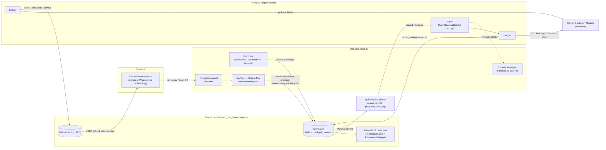

# On the House

**Promos like "if Bitcoin is above $71,000 at 8 PM, your coffee is free" — at a fixed cost the shop knows upfront.**

Every sale is recorded on **Solana** and gives the customer a non-transferable refund claim. A hedging engine sees each
sale in real time through **QuickNode Streams** and immediately buys matching **Gemini prediction-market** contracts
(each pays $1 if YES) to cover every refund promised. A public proof page shows refunds promised vs. covered. If the
market settles YES, the Solana program pays every customer automatically; if it settles NO, the shop has only paid the
small premium it saw before launching.

> University Blockchain Conference 2026 hackathon — Consumer Applications track · Solana · Gemini Prediction Markets ·
> QuickNode Streams. Everything runs on **Solana devnet** and the **Gemini sandbox** with test money.

---

## The problem

Event-contingent promotions ("free if the Bears win", "50% back if it snows") drive real foot traffic, and shops already
hedge them — by hand, after the fact, if at all. A shop that promises refunds on every sale carries open-ended risk:
a good promo day plus the event happening can wipe out a month of margin. So most shops don't run them.

What's missing is plumbing: price the promo per sale, cover each refund the moment it's promised, prove the coverage,
and pay customers without anyone processing refunds.

## How it works



1. **Shop launches a promo** (`/merchant`): picks a live Gemini market, a refund % and its limits. The page shows the
   cost before launching: *"This promo costs you 27.5% of each sale."* `create_campaign` creates the campaign account,
   a Token-2022 claim mint and a refund vault.
2. **Customer pays** (`/shop/[campaign]`): an in-browser burner wallet (funded with demo dollars, needs no SOL) or a
   Solana Pay QR for Phantom. Both hit the same Solana Pay **transaction request** endpoint, which builds `purchase`
   with the live premium and partially signs it as the operator and fee payer. In one atomic instruction the program
   sends `amount − premium` to the shop, `premium` to the platform treasury, mints the refund claim to the customer and
   increases the campaign's liability.
3. **Engine hedges** within seconds: target = ⌈liability / $1⌉ contracts; it buys the difference on Gemini with an
   immediate-or-cancel limit order at no more than the campaign's max price, then writes `record_hedge` on-chain — the
   public proof of coverage.
4. **Market resolves**: the engine reads Gemini's resolution, calls `settle`, funds the refund vault and runs `payout`
   for every claim holder. Payout burns the customer's whole claim and transfers the same amount of USDC.

## Verified end to end (Nov 12, 2026)

| Run | What happened |
|---|---|
| Gemini sandbox, **YES** | Promo "50% back if ETH ≥ $2,000 at 6 PM ET". $3 sale → hedger bought **2 YES @ $0.87** on the Gemini sandbox (order `145853902317856659`) and recorded it on Solana. Gemini resolved YES and its settled-positions API reports a **$2.00 payout**; the engine settled on Solana and refunded the customer **exactly $1.50, 16 s after the market closed**, burning the claim. |
| Gemini sandbox, **NO** | XRP 15-minute market: real sandbox hedge (3 YES @ $0.50), Gemini resolved NO, customer paid $0, claim left worthless. |
| QuickNode Streams | A devnet transaction from the program was delivered by Streams to the engine's webhook (HMAC-verified) **in the same second** it confirmed. |
| `pnpm demo:e2e` | 3 customers YES (exact refunds, claims burned) + 2 customers NO (nothing paid), on devnet in ~40 s. |

Verify any hedge against Gemini's own records: `pnpm verify:orders <Gemini order id | campaign address>`.

## Solana

**Program:** `on_the_house` (Anchor 1.2.2) —
[`4qfLMXZTmKt71eDH4S3VNSDCRFPX7qxpPk3WZZgt2PM2`](https://explorer.solana.com/address/4qfLMXZTmKt71eDH4S3VNSDCRFPX7qxpPk3WZZgt2PM2?cluster=devnet) on devnet.

| Instruction | Who | What |
|---|---|---|
| `initialize_config` / `update_config` | admin (program upgrade authority) | operator, treasury, USDC mint |
| `create_campaign` | merchant | campaign PDA + claim mint + refund vault; refund %, max premium %, liability cap, **max unhedged**, sales deadline |
| `purchase(amount, premium)` | customer **and** operator | payment split, claim mint, liability update, all caps enforced |
| `record_hedge(contracts, avg_price, order_ref_hash)` | operator | on-chain proof of coverage (`HedgeRecorded`) |
| `set_paused` | merchant or operator | pause/resume sales |
| `settle(outcome)` | operator | Yes / No after resolution |
| `payout(customer)` | anyone (crank) | burn the claim via permanent delegate, pay the same amount in USDC |
| `close_claims`, `cancel_campaign` | — | burn worthless claims after No; cancel a campaign with no sales |

How Solana is used:

- **On-chain exposure cap.** `purchase` rejects a sale if `liability − hedged_contracts × $1 > max_unhedged`
  (saturating) or `liability > liability_cap`, and if `premium > amount × max_premium_bps`. The shop's worst case is
  enforced by the program, not by trusting the engine.
- **Token-2022 claim token**, one mint per campaign, 6 decimals (claim balance = refund owed in USDC base units), with
  **NonTransferable** (claims can't be sold or moved) and **PermanentDelegate** = campaign PDA (payout can burn claims
  without the customer signing). USDC stays on the classic Token program; instructions handle both.
- **Solana Pay transaction requests** (`GET/POST /api/pay/[campaign]`): the server returns a transaction partially
  signed by the operator, who is the fee payer and pays for new token accounts — **customers need zero SOL**. A
  Solana Pay `reference` key lets the checkout page detect a QR payment.
- **Events** (`emit!`): `PurchaseEvent`, `HedgeRecorded`, `CampaignSettled`, `PayoutEvent`, … drive the engine and the
  proof page. Ingest is idempotent (signature + event index).
- 14 LiteSVM tests cover payment split, premium cap, liability cap, `max_unhedged` enforcement and recovery after
  `record_hedge`, non-transferable claims, operator-only settle/record, exact payout + burn, and payout failing before
  settlement or after No (`pnpm program:test`).

## Gemini

- **Market data** (public): `GET /v1/prediction-markets/events` / `events/{ticker}` for the merchant's market browser,
  live YES prices, and resolution (`resolutionSide`). Shown in plain language ("BTC is $71,000 or above today at 8pm EST").
- **Trading** (sandbox only — the client throws for any host other than `api.sandbox.gemini.com`): signed private REST
  (base64 JSON payload, HMAC-SHA384), terms-acceptance check, `POST /v1/prediction-markets/order` as
  **immediate-or-cancel limit buys of YES** (never leaves resting orders), cancel, active orders + history (used to
  reconcile after timeouts, since the API has no client order id), positions, and **settled positions** (Gemini's payout),
  which the proof page shows next to the refunds paid on Solana.
- **Pricing:** premium = amount × refund % × YES ask × (1 + platform margin). The highest acceptable hedge price follows
  from the shop's max cost: `p ≤ max_premium / (refund × (1 + margin))`, capped at $0.99 (Gemini rejects $1.00).
- **Mock mode** (`GEMINI_MODE=mock`): an in-memory order book seeded with real Gemini prices, instant fills, and an
  admin endpoint to resolve — labeled **SIMULATED** everywhere it appears.

## QuickNode Streams

| | |
|---|---|
| Network / dataset | `solana-devnet` / `programs_with_logs` |
| Filter | [`engine/quicknode/filter.js`](engine/quicknode/filter.js): keeps only successful transactions that invoke our program; forwards `signature`, `slot`, `blockTime`, and the log lines (Anchor events live in `Program data:` logs) |
| Destination | webhook `POST {PUBLIC_ENGINE_URL}/webhooks/quicknode` |
| Security | `X-QN-Signature` = hex HMAC-SHA256(security token, nonce + timestamp + body), verified with a constant-time compare, a ±5 min timestamp window and a nonce replay cache |
| Why | the hedger must cover each sale before the next one (the on-chain `max_unhedged` cap blocks sales otherwise); a push stream is faster and more reliable than websocket subscriptions on public devnet, which drop messages. A periodic `getSignaturesForAddress` backfill feeds the same deduplicated handler as a safety net. |

`pnpm stream on` creates the stream at the current slot; `pnpm stream off` deletes it (Streams bills every processed
block, and on the free plan a stream that falls >100 blocks behind is terminated). `pnpm stream test [slot]` runs the
filter against a real devnet slot.

## Economics and risk

- **The shop's cost is fixed per sale** and shown before launch; sales pause automatically if the live hedge price
  would exceed the shop's max cost, and resume when it comes back.
- **The platform earns the margin** (default 10%) on top of the hedge price. Each contract pays $1 on YES, so covered
  refunds are paid out of Gemini's payout.
- **Trust assumption — operator between Gemini and Solana.** Gemini pays the platform's account; the operator moves
  that money into the campaign's refund vault before payouts. The program guarantees that whatever reaches the vault
  goes to the right customers in the right amounts, but not that the operator funds it. In this demo the operator mints
  mock dUSDC to fund the vault (sandbox dollars can't move to devnet).
- **Unhedged window.** Between a sale and its hedge the shop is exposed; the program caps this at `max_unhedged`
  and the hedger runs within seconds of each sale. Whole-contract rounding means coverage is always ≥ the refunds.
- **Liquidity.** Thin books mean a hedge may not fill under the max price — the engine pauses sales rather than sell
  uncovered. Gemini also stops accepting orders ~10 minutes before a market closes, so sales stop 12 minutes before close.
- **Resolution source.** Settlement follows Gemini's own resolution (`resolutionSide`) — the same source that pays the
  hedge, so the refund and the hedge can't disagree.
- **Operator key.** The operator co-signs every purchase (authorizing the premium) and records hedges; a compromised
  operator could misprice premiums within the shop's cap or misreport hedges (each one carries a hash of the Gemini
  order id, checkable with `pnpm verify:orders`).

## Run it

Requirements: Node ≥ 22.13, pnpm 10, Solana CLI 4.1 and Anchor 1.2.2 (only to build/deploy the program), Docker
(optional, for the engine image).

```sh
pnpm install
cp .env.example .env            # optional: Gemini sandbox key/secret, QuickNode endpoint + API key
pnpm program:build && pnpm program:test     # build the program, run the 14 LiteSVM tests
pnpm setup:devnet               # keys, dUSDC mint, deploy, config; writes .env and app/.env.local
pnpm dev:engine                 # terminal 1 — engine on :8787
pnpm dev:app                    # terminal 2 — web app on :3000
```

Then open `http://localhost:3000/merchant`, launch a promo, open its shop, add demo dollars, tap to pay, and watch the
proof page. Useful commands:

| Command | What |
|---|---|
| `pnpm demo:e2e` | YES + NO campaigns end to end on devnet (mock Gemini) |
| `pnpm demo:sandbox` | live run on a Gemini sandbox market that settles soon (real hedge + real resolution) |
| `pnpm smoke:app` | the web app's API flow (launch, faucet, Solana Pay checkout, coverage) |
| `pnpm verify:orders <id>` | match a campaign's hedges to Gemini sandbox order history |
| `pnpm gemini:probe` | read-only check of the Gemini sandbox credentials |
| `pnpm stream on \| off \| status \| test` | QuickNode Stream control |
| `pnpm test` | unit tests (money math, Gemini client, QuickNode webhook verification) |

Every integration has a mock mode so the demo runs without credentials: `GEMINI_MODE=mock|sandbox`,
`INGEST_MODE=poll|quicknode`, `RESOLUTION_SOURCE=mock|production|sandbox`. All settings are documented in
[`.env.example`](.env.example) and [`app/.env.example`](app/.env.example).

**Deploy:** the web app deploys to Vercel (root directory `app`); the engine runs anywhere Docker does —
[`engine/Dockerfile`](engine/Dockerfile) and [`railway.json`](railway.json) are set up for Railway, with the SQLite
database on a volume (`DATABASE_PATH=/data/oth.sqlite`).

## Repository

```
programs/on_the_house/   Anchor program (Rust) + LiteSVM tests
engine/                  hedging engine: ingest, hedger, settler, Gemini + QuickNode clients, HTTP API + SSE
engine/quicknode/        Streams filter
app/                     Next.js web app: /merchant, /shop/[campaign], /me, /proof/[campaign], API routes
packages/shared/         money math, program client (IDL, instruction builders), env validation, API types
scripts/                 devnet setup, QuickNode stream control, end-to-end demos
docs/research/           API docs and specs the integrations were built from
```

## What's next

- **Close the trust gap**: move Gemini payouts to the refund vault automatically (Gemini → USDC on Solana) and publish
  attestations of the hedge account, or let shops fund the vault upfront with the worst-case amount.
- **Point-of-sale integrations** (Square / Shopify / Toast) so a promo is a toggle, not a new checkout.
- **More markets**: sports and weather promos ("free hot cocoa if it snows"), and campaigns that combine markets.
- **Better hedging**: partial fills across price levels, hedging the NO side to sell back coverage, and batching small
  sales into whole contracts.
- **Mainnet**: an audit of the program, real USDC, and Gemini production trading.

## License

MIT
