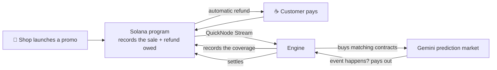

# On the House

**Run promos like "your coffee is free if Bitcoin is above $71,000 at 8 PM" — without betting the shop.**

Shops love promos tied to real events. The problem is risk: if the event happens, the shop owes everyone a refund.
On the House turns that into a small, fixed cost per sale that the shop sees before launching.

Here's the idea: every time a customer buys something, we buy a prediction-market contract that pays out if the event
happens. If it does, that payout refunds the customer. If it doesn't, the shop only paid a small premium.

Built for the University Blockchain Conference 2026 hackathon (Consumer Applications) using **Solana**, **Gemini
Prediction Markets** and **QuickNode Streams**. Everything runs on Solana devnet and the Gemini sandbox with test money.

---

## How it works



1. **The shop picks an event and a refund.** For example: 100% back if BTC is above $71,000 at 8 PM. The app shows the
   cost right away — *"This promo costs you 27.5% of each sale."*
2. **A customer pays** like any normal checkout. They get a receipt that says *"If BTC is above $71,000, you get $4.00
   back."* Behind the scenes they also get a refund token that can't be transferred.
3. **Within seconds, the engine covers the refund** by buying YES contracts on Gemini (each pays $1 if the event
   happens), then writes that coverage onto Solana.
4. **Anyone can check the coverage** on the public proof page: refunds promised vs. refunds covered, with links to every
   transaction.
5. **When the market settles**, the Solana program automatically refunds every customer if the answer is YES. If it's
   NO, nothing happens — the shop kept its sales and only paid the premium.

### Where the money goes ($4 sale, 25¢ market price, 100% refund)

| | Shop | Customer | Platform |
|---|---|---|---|
| At checkout | gets $2.90 | pays $4.00 | gets $1.10, spends $1.00 on 4 contracts |
| If YES | keeps $2.90 | gets **$4.00 back** | Gemini pays $4.00 → all of it goes to the customer |
| If NO | keeps $2.90 | keeps the coffee | contracts expire |

The shop's cost is the same either way. The platform keeps a 10% margin on the hedge.

## What we tested live

- **A real YES:** a promo on "ETH above $2,000 at 6 PM ET". After a $3 sale, the engine bought 2 YES contracts on the
  Gemini sandbox. ETH finished above $2,000, Gemini paid out $2.00, and the customer got their $1.50 back on Solana
  **16 seconds after the market closed.**
- **A real NO:** same flow on an XRP market. Gemini said NO, nobody was paid, and nobody was owed anything.
- **QuickNode:** a sale on Solana reached our engine through QuickNode Streams in the same second.
- **Safety:** when a hedge couldn't be bought, the engine paused the promo on its own and resumed once covered.

## How we use each technology

**Solana** — the program ([`programs/on_the_house`](programs/on_the_house), deployed at
[`4qfLMXZTmKt71eDH4S3VNSDCRFPX7qxpPk3WZZgt2PM2`](https://explorer.solana.com/address/4qfLMXZTmKt71eDH4S3VNSDCRFPX7qxpPk3WZZgt2PM2?cluster=devnet)
on devnet) handles the money:
- Each purchase splits the payment between the shop and the platform and records the refund owed — all in one step.
- **The shop's risk is capped on-chain.** The program refuses a sale if the uncovered refunds would go over the limit the
  shop chose. Nobody has to trust our engine for this.
- Refund claims are **Token-2022** tokens that **can't be transferred**, and the program can burn them when it pays out.
- Checkout uses **Solana Pay**. The platform pays the transaction fees, so customers never need SOL.

**Gemini** — where the coverage is bought:
- Live prediction markets and prices for the shop to choose from.
- Real orders in the Gemini sandbox: the engine buys exactly enough YES contracts to cover every refund, never above the
  shop's maximum price. Our code refuses to trade anywhere except the sandbox.
- Gemini's own result decides the outcome, so the refund and the hedge always agree.

**QuickNode Streams** — how the engine hears about sales:
- A stream on Solana devnet filtered down to our program ([filter](engine/quicknode/filter.js)) pushes each sale to the
  engine's webhook within a second. Every delivery is signature-checked.
- Speed matters: the engine has to cover each sale before the shop's risk limit fills up.

## The honest part (risks)

- **One trust step.** Gemini pays the platform, and the platform moves that money into the refund pool on Solana. The
  program guarantees the pool pays the right customers the right amounts, but not that the platform fills it. In this
  demo, that step is simulated with test dollars. Today the engine is the bridge, and it posts a record of every hedge
  on Solana — see below for how Gemini could remove the need to trust us at all.
- **A few seconds of exposure.** Between a sale and its hedge, the shop isn't covered yet. The on-chain cap limits how
  much.
- **Thin markets.** If contracts can't be bought at a fair price, sales pause instead of going uncovered. Gemini also
  stops trading about 10 minutes before a market closes, so promos stop selling 12 minutes before.
- **It's all test money** right now — Solana devnet and the Gemini sandbox.

## What Gemini could add

As far as we know, Gemini doesn't offer any of these today. Each one would remove the trust step above — so no one has
to take our engine's word for anything.

1. **Signed statements (simplest).** Gemini signs short messages like *"Account X holds 1,240 YES contracts on market M"*
   and *"Market M resolved YES."* Our engine passes them to the Solana program, which checks the signature with
   Solana's built-in Ed25519 verification before updating coverage or paying out. Then users only trust Gemini — a
   regulated exchange that already holds the money.
2. **Results posted on Solana.** Gemini publishes market outcomes on-chain itself, like Pyth does for prices. Our program
   just reads the answer.
3. **Contracts as Solana tokens.** Gemini's contracts live on Solana. Our program holds them and cashes them in
   automatically, with no middleman at all.

What we can do without Gemini's help:
- **Shop pre-funds refunds.** The shop locks the maximum refund in the program upfront, so payouts never depend on our
  engine moving money.
- **Double-check results.** Confirm price-based outcomes (like "BTC above $71,000") against Pyth's on-chain price feed.

## Run it yourself

You'll need Node 22+, pnpm 10, and (only to rebuild the program) the Solana CLI and Anchor 1.2.2.

```sh
pnpm install
pnpm setup:devnet      # creates keys, test dollars, deploys the program, writes the config
pnpm dev:engine        # terminal 1
pnpm dev:app           # terminal 2
```

Open **http://localhost:3000**, tap **Start your promo**, add your shop and menu, launch, and you get a shareable link and a
printable QR code. Open the link as a customer, add demo dollars, and pay — then watch the protection page.

Shop owners sign in with **Privy** (email or Google; a wallet is created invisibly and stays under the owner's control).
Set `NEXT_PUBLIC_PRIVY_APP_ID` in `app/.env.local`; without it the app runs as a single demo shop.

No API keys? It still works — every integration has a simulated mode, clearly labeled **SIMULATED** in the app. Settings
are explained in [`.env.example`](.env.example).

Handy commands:
- `pnpm demo:e2e` — runs a full YES and NO promo on devnet
- `pnpm smoke:owner` — a shop owner signs their own shop and promo (the Privy path)
- `pnpm verify:orders <order id>` — checks a hedge against Gemini's own records
- `pnpm stream on` / `pnpm stream off` — start or stop the QuickNode stream
- `pnpm test` — unit tests · `pnpm program:test` — Solana program tests

## License

MIT
